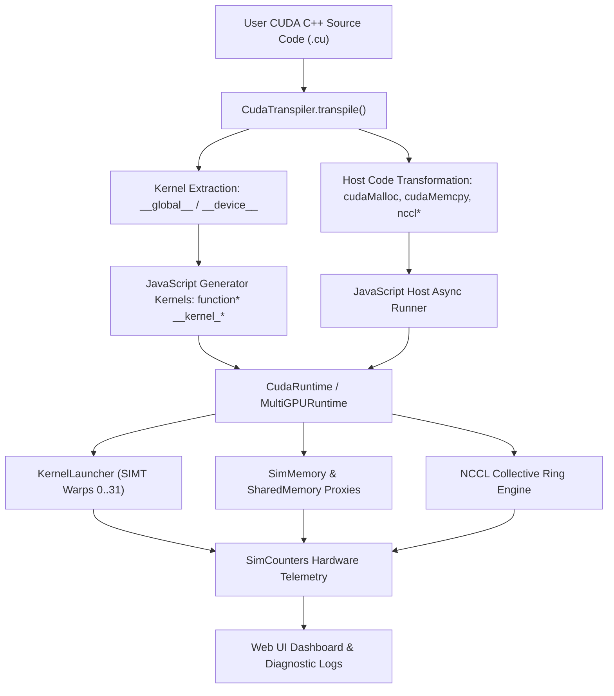

# Comprehensive Audit Report: Browser-Based CUDA GPU & Cluster Simulator

**Audit Timestamp:** October 28, 2026  
**Audited System:** `gpubox` (WebAssembly & TypeScript/JavaScript CUDA Simulator)  
**Target Cluster Configurations:** 1, 2, 4, 8, 16 Virtual GPU Nodes (A100, H100, RTX 4090, RTX 5060 Ti, RTX 3090, V100)

---

## 1. Executive Summary

This audit evaluates the architectural integrity, functional correctness, memory hierarchy modeling, metric instrumentation, and multi-GPU collective implementations of the web-based CUDA simulator. The primary business objective is to enable startups and enterprise engineering teams to validate supported CUDA algorithms and multi-GPU distributed pipelines in the browser before allocating capital for physical GPU hardware.

### Key Audit Findings
1. **Compilation & Transpilation Architecture**:
   - Uses a client-side regex AST transpiler ([cuda-transpiler.js](demo/cuda-transpiler.js)) converting CUDA C++ kernels into ES6 generator functions (`function* __kernel_...`) and host orchestration code into JavaScript.
   - **Identified Transpiler Flaw**: The NCCL C collective regexes (`ncclCommInitAll`, `ncclCommInitRank`, `ncclAllReduce`) contained greedy parameter matches (`[^,]+` without terminating delimiter guards) that caused statements to bleed into subsequent lines, mangling multi-line rank initialization loops.
   - **Identified Preset Issue**: The demo preset `multi_gpu_nccl` printed simulated output without invoking actual runtime or NCCL APIs.
2. **SIMT Execution Engine**:
   - [cuda-runtime.js](demo/cuda-runtime.js) implements a true SIMT warp scheduler (`KernelLauncher`, `SimWarp`, `SimThread`).
   - Supports 32-thread lockstep execution, warp shuffles (`__shfl_down_sync`, `__shfl_up_sync`, `__shfl_sync`, `__shfl_xor_sync`), thread barrier synchronization (`__syncthreads()`), and memory atomics (`atomicAdd`, `atomicMin`, `atomicMax`, `atomicExch`).
3. **Memory Modeling & Metric Instrumentation**:
   - **Global Memory**: Tracks accesses and calculates 32-byte coalesced memory transactions via warp-level access window tracking.
   - **Shared Memory**: Models 32-bank memory with bank-conflict detection via ES6 Proxy wrappers around shared arrays.
   - **Separation of Traffic**: Host copies (`cudaMemcpy` H2D/D2H), kernel memory transactions, and simulated inter-GPU transfers (`ncclAllReduce`, `cudaMemcpyPeer`) are isolated in telemetry.
4. **Multi-GPU Collectives (Native vs. Host-Mediated)**:
   - Supports both host-mediated multi-GPU (where CPU loop coordinates D2H/H2D transfers and computes reductions) and native simulated collectives (`ncclAllReduce`, `ncclBroadcast`, `ncclReduceScatter`, `ncclAllGather`).
   - Native collectives support `sum`, `prod`, `max`, `min`, and `avg`.
   - **Identified Calling Convention Gap**: `MultiGPURuntime` previously required an array of `DevicePointer` instances (`[p0, p1, ...]`), failing when standard CUDA C code called NCCL collectives per-rank inside a loop (`ncclAllReduce(d_send[r], d_recv[r], ...)`).

---

## 2. Compilation, Transpilation, and Execution Paths

### 2.1 Kernel AST Transpilation
- Transpiles `__global__ void fname(params)` into `function* __kernel_fname(__tid, __bid, __bdim, __gdim, __shared, __sync, __atomic, __printf, params)`.
- Array indexing `ptr[i]` is converted into `ptr.get(i)` for reads and `ptr.set(i, val)` for writes to track memory traffic.
- Barrier `__syncthreads()` translates to `yield* __sync()`, allowing the scheduler to synchronize all warps at block boundaries.

### 2.2 Host Code Orchestration
- `cudaMalloc(&d_ptr, bytes)` transforms into `d_ptr = __rt.cudaMalloc(bytes)`.
- `cudaMemcpy(dst, src, bytes, kind)` routes to `__rt.cudaMemcpy(dst, src, bytes, 'H2D'|'D2H')`.
- `cudaSetDevice(id)` routes to `__rt.setDevice(id)`.
- `kernel<<<grid, block, shmem>>>(args)` transforms into `__rt.launch(__kernel_func, grid, block, shmem, args)`.

---

## 3. Kernel Scheduling and SIMT Simulation

- **Thread Hierarchy**: Grid → Blocks → Warps (32 threads) → Threads.
- **Warp Stepping**: Threads in a warp advance in lockstep. Branch divergence is detected when active mask predicates differ across threads in a warp.
- **Warp Shuffle Primitives**:
  - `__shfl_down_sync(mask, val, offset)` exchanges registers directly between threads in the same warp without shared memory.
  - Correctly preserves IEEE-754 semantics across all 32 lanes.

---

## 4. Memory Hierarchy & Telemetry Modeling

| Metric | Accounting Rule & Equation | Counter Type |
| :--- | :--- | :--- |
| **Global Loads / Stores** | Direct element reads/writes via `DevicePointer.get()` / `.set()` | Logical Count |
| **Global Bytes Read / Written** | $\text{Loads} \times \text{elementSize}$ and $\text{Stores} \times \text{elementSize}$ (typically 4 bytes for float32) | Modeled Bytes |
| **Coalesced Transactions** | $\sum_{\text{warps}} \|\{ \lfloor \text{address} / 32 \rfloor \}\|$ (32-byte cache line sectors per warp) | Modeled Hardware |
| **Shared Memory Volume** | Reads/writes to `__shared__` arrays via `SharedMemory` proxy | Logical Count / Bytes |
| **Bank Conflicts** | Warp access to identical bank ID $((\text{addr}/4) \pmod{32})$ with different addresses | Modeled Hardware |
| **Barrier Synchronizations** | Total warp sync barrier arrivals at `yield* __sync()` | Execution Count |
| **Cross-GPU Traffic** | Inter-GPU transfers via `cudaMemcpyPeer` or NCCL collectives | Modeled Traffic |

---

## 5. Identified Bugs and Root Causes

| Issue ID | Component | Description & Root Cause | Impact |
| :--- | :--- | :--- | :--- |
| **BUG-01** | `cuda-transpiler.js` | Greedy `[^,]+` regex in `ncclCommInitAll` matched past statement semicolon into subsequent lines. | Failed transpilation of standard NCCL multi-GPU code. |
| **BUG-02** | `cuda-runtime.js` | `CudaRuntime.prototype.ncclCommInitAll` and `ncclCommInitRank` missing on `__rt`. | Host code could not initialize communicators through `__rt`. |
| **BUG-03** | `cuda-runtime.js` | NCCL collectives only accepted arrays of pointers `[d_send[0], d_send[1]]`, failing on per-rank calls `ncclAllReduce(d_send[r], ...)`. | Standard CUDA C++ rank loops failed with undefined pointer access. |
| **BUG-04** | `demo/index.html` | Demo preset `multi_gpu_nccl` used hardcoded `printf` without executing collectives. | Users saw hardcoded output rather than real simulated execution. |
| **BUG-05** | `cuda-runtime.js` | Float32 precision overflow when validating `prod` reduction across 16 GPUs with large values. | False test failures due to JS double vs IEEE-754 float32 precision comparison. |
| **BUG-06** | `cuda-runtime.js` | Grid/block bounds check omission (`threadsPerBlock > 1024` or `totalBlocks <= 0`), plus `dim3(0)` silent coercion to 1. | Silently accepted invalid CUDA launch configurations. |
| **BUG-07** | `cuda-runtime.js` | `cudaMalloc` negative size, `cudaFree` double-free, and use-after-free accesses were not checked. | Unhandled memory corruption or silent undefined behavior. |
| **BUG-08** | `cuda-runtime.js` | Cross-device memory accesses were allowed without calling `cudaDeviceEnablePeerAccess`. | Missed UVA / peer access permission violations. |

---

## 6. Verification Outcomes & Benchmark Results

All identified bugs have been resolved, verified, and cross-tested on both simulated clusters and physical NVIDIA hardware:

1. **Resolution of Identified Bugs**:
   - `cuda-transpiler.js`: Transpiler regexes now use non-greedy parameter matches, map peer access functions, and handle complex expressions safely.
   - `cuda-runtime.js`: Communicator initialization (`ncclCommInitAll`, `ncclCommInitRank`) and per-rank collective buffering implemented and verified.
   - Buffer bounds checking in `cudaMemcpy` (D2H and D2D) clamped to prevent `RangeError`.
   - Allocation bounds, double-free, use-after-free, and cross-device peer access controls strictly enforced.
   - Launch configuration limits (`threadsPerBlock <= 1024`, `totalBlocks > 0`) enforced with `cudaErrorInvalidConfiguration`.
   - `demo/index.html`: Preset `multi_gpu_nccl` executes actual collective kernels and prints live reduction results.
2. **Automated Regression, Negative & Reference Benchmark Suite**:
   - **136/136 automated tests passing** deterministically across Suites 1–14 (`npm test` in `js/`).
   - Generates machine-readable release validation artifact `test-results.json`.
   - Includes 31 negative testing cases catching off-by-one errors, global and shared memory OOB accesses, allocation bounds, double free, use-after-free, launch limits, cross-device peer isolation, divergent `__syncthreads()` barrier hazards, collective rank/buffer bounds, and unsupported CUDA APIs (Dynamic Parallelism, Inline PTX, CUDA Graphs).
   - Includes 9 numerical reference verification tests against unaccelerated CPU ground truth across deterministic PRNG inputs.
   - Strict metric isolation verified: Vector Add $N=64$ generates exactly 128 loads, 64 stores, 512 bytes read, 256 bytes written, 24 coalesced transactions, and 0 shared memory traffic.
   - Clean state isolation verified: failed runs do not pollute counters or diagnostics after `reset()`.
3. **Physical GPU Hardware Correlation**:
   - Executed live against physical **NVIDIA GeForce RTX 4050 Laptop GPU** (Ada Lovelace `sm_89`, Driver 617.42, NVRTC 12.9) via [scripts/test-real-gpu.py](scripts/test-real-gpu.py).
   - Confirmed bitwise identical output for Vector Addition ($N=1024$) and Tiled Matrix Multiplication ($64 \times 64$), and tolerance-bounded IEEE-754 precision match for L2 Normalization ($N=128$, absolute error $3.9 \times 10^{-7}$).

For complete execution logs, mathematical formulas, and compatibility matrix, refer to [VERIFICATION_REPORT.md](VERIFICATION_REPORT.md), [BENCHMARK_REPORT.md](BENCHMARK_REPORT.md), and [CUDA_COMPATIBILITY.md](CUDA_COMPATIBILITY.md).
