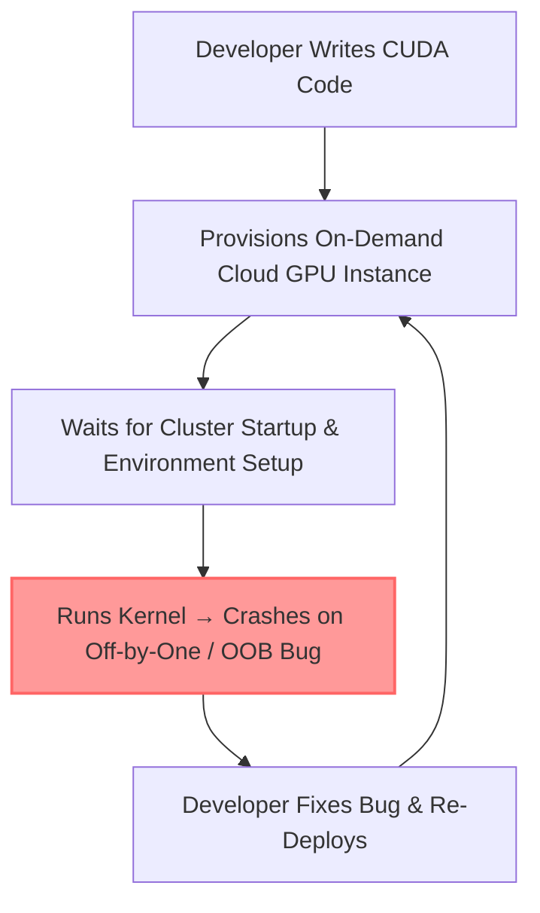

# Business Strategy & Product Vision: `cuda-sim`

**Product Name:** `cuda-sim` (`@trentorch/cuda-sim`)  
**Product Positioning:** *A browser-based pre-validation environment that helps developers catch supported CUDA logic errors and test multi-GPU algorithms before paying for hardware.*  
**Working Principle:** **Validate early. Catch errors sooner. Spend GPU resources where real hardware is necessary.**

---

## 1. Executive Overview

Modern AI development and GPU computing require significant capital and operational expenditure. Engineering teams, AI startups, researchers, and students frequently deploy code directly to physical or cloud-hosted GPUs (such as NVIDIA H100, A100, or RTX 4090 clusters) simply to check if their CUDA kernels compile, if memory indexing is valid, or if multi-GPU collective communications function logically.

`cuda-sim` disrupts this costly development pattern by providing a **client-side, browser-native pre-validation environment** powered by WebAssembly (WASM) and JavaScript. It enables developers to write, inspect, simulate, and debug supported CUDA C++ code and distributed multi-GPU workflows directly on their local machines or in a web browser—with zero server costs and zero cloud GPU provisioning.

The goal of `cuda-sim` is not to replace physical GPU hardware for production workloads, but to serve as a **critical pre-validation filter** that catches supported CUDA coding bugs, race conditions, memory violations, and distributed collective logic errors early in the development lifecycle.

---

## 2. Buyer Problem: Why Customers Need This

Developing and validating GPU applications currently presents significant friction for organizations:



### Core Buyer Pain Points

1. **Expensive Early-Stage GPU Runs:**  
   Engineers frequently reserve on-demand cloud GPU instances to perform rudimentary functional testing, iterative syntax checks, and kernel debugging. When code crashes due to basic memory bounds violations or collective misconfigurations, valuable GPU budget is wasted on avoidable debugging cycles.
2. **Slow Feedback & Debugging Loops:**  
   Deploying code to physical GPU instances or shared enterprise clusters involves queuing, container orchestration, cloud initialization, and environment synchronization. Iterating on a kernel logic bug often takes minutes per run rather than seconds.
3. **Hardware Access Bottlenecks:**  
   Individual engineers, R&D researchers, and remote developers often work on standard laptops without dedicated NVIDIA workstation GPUs. They are forced to rely on shared remote servers or wait for access to limited internal GPU clusters.
4. **Educational & Training Barriers:**  
   Universities, bootcamps, and EdTech platforms struggle to teach CUDA programming because requiring every student to have an NVIDIA-equipped machine or an active cloud GPU account is cost-prohibitive and operationally complex.
5. **Interactive Developer Platform Limitations:**  
   Developer portals, technical documentation sites, and coding assessment platforms cannot easily offer live, interactive CUDA execution sandboxes without maintaining costly, security-sensitive backend GPU server farms.

---

## 3. The Solution: Client-Side Pre-Validation

`cuda-sim` provides a lightweight, zero-install, browser-based runtime that executes supported CUDA C++ kernels and simulates multi-GPU clusters in memory:

* **Pure Client-Side Architecture:** Runs 100% inside the browser or local Node.js environment using WebAssembly and JavaScript. No remote servers, no streaming video, and no backend GPU infrastructure required.
* **SIMT Execution & Warp Scheduler:** Models 32-thread lockstep warps, branch divergence, barrier synchronizations (`__syncthreads()`), and warp shuffle intrinsics (`__shfl_down_sync`, `__shfl_sync`).
* **Memory Hierarchy & Telemetry:** Simulates 32-bank shared memory with bank-conflict detection, tracks 32-byte coalesced global memory transactions, and computes logical read/write bandwidth counters.
* **Simulated Multi-GPU Clusters:** Scales to 2, 4, 8, and 16 virtual GPU nodes, supporting peer-to-peer copies (`cudaMemcpyPeer`) and standard collective operations (`ncclAllReduce`, `ncclBroadcast`, `ncclReduceScatter`, `ncclAllGather`).
* **Diagnostic Bug Detection:** Catches off-by-one indexing, out-of-bounds reads/writes, divergent barrier deadlocks, invalid collective roots, and buffer length mismatches with exact kernel, thread, and block context.

---

## 4. Target Customers & Business Value

```
┌────────────────────────────────────────────────────────────────────────────────────────┐
│                               Target Customer Segments                                 │
├──────────────────────────┬──────────────────────────┬──────────────────────────────────┤
│ AI Startups & Companies  │ Enterprise AI Teams      │ EdTech Platforms & Universities  │
│ • Pre-validate kernels   │ • Catch bugs in CI/CD    │ • Zero-hardware CUDA courses     │
│ • Save cloud GPU budget  │ • Team pre-flight test   │ • Interactive coding assignments │
│ • Fast algorithm design  │ • Reduce cluster queue   │ • Scalable student sandboxes     │
├──────────────────────────┼──────────────────────────┴──────────────────────────────────┤
│ Internal R&D Teams       │ Developer Platforms & Playgrounds                           │
│ • Algorithm prototyping  │ • Live documentation code snippets                          │
│ • Distributed modeling   │ • Browser-based technical interviews & evaluations          │
│ • Shared testbeds        │ • Zero-backend interactive tutorials                        │
└──────────────────────────┴─────────────────────────────────────────────────────────────┘
```

### 1. AI Startups and Machine Learning Companies
* **Profile:** Seed- to Growth-stage AI companies building specialized model architectures, custom inference kernels, or domain-specific neural networks.
* **Customer Value:**  
  * Pre-validate custom CUDA kernels, normalization layers, reductions, attention mechanisms, and multi-GPU tensor-parallel pipelines before spending scarce runway on physical cloud GPU hours.
  * Accelerate the build-test-debug loop for early prototype kernels on local developer laptops.

### 2. Enterprise AI & Systems Engineering Teams
* **Profile:** Enterprise engineering teams at hyperscalers, autonomous systems companies, financial institutions, and tech enterprises.
* **Customer Value:**  
  * Enable large software teams to test CUDA algorithms and catch logic errors early in local development environments.
  * Reduce queue contention on internal physical GPU clusters by filtering out buggy code before it reaches the hardware test harness.
  * Integrate into local developer tooling to ensure code satisfies basic functional correctness before submission.

### 3. Internal Engineering and R&D Teams
* **Profile:** Core research, systems architecture, and distributed systems groups exploring new parallel computing concepts.
* **Customer Value:**  
  * Provide a shared, zero-friction environment to experiment with CUDA algorithms, memory layout optimizations, and multi-node collective communication patterns without needing dedicated hardware reservations.
  * Prototype distributed communication topologies (2, 4, 8, 16 virtual nodes) locally before requesting access to high-demand supercomputing clusters.

### 4. EdTech Platforms and Universities
* **Profile:** Computer science departments, online learning platforms (Coursera, edX, Udacity), and specialized high-performance computing (HPC) bootcamps.
* **Customer Value:**  
  * Offer browser-based CUDA learning, interactive parallel programming exercises, and homework validation without requiring students to own NVIDIA hardware or set up complex local toolchains.
  * Eliminate the infrastructure cost and security risks of hosting backend GPU sandbox servers for thousands of concurrent students.

### 5. Developer Platforms and Online Coding Playgrounds
* **Profile:** Technical documentation portals, online coding interview platforms, API playgrounds, and developer blogs.
* **Customer Value:**  
  * Embed interactive CUDA code snippets directly into web documentation, allowing developers to execute, modify, and observe kernel behavior in real time.
  * Power technical hiring assessments and coding challenges with instant client-side execution and automated functional verification.

---

## 5. Core Business Benefits

| Benefit | Practical Impact |
| :--- | :--- |
| **Lower Development Costs** | Eliminates avoidable cloud GPU spending by enabling engineers to debug basic logic, syntax, and memory indexing errors on local machines before provisioning physical instances. |
| **Faster Feedback Loops** | Reduces iteration latency from minutes (cloud instance launch, SSH, container build) to milliseconds (instant client-side compilation and execution). |
| **Earlier Bug Detection** | Detects memory out-of-bounds accesses, divergent barrier deadlocks, and communicator argument mismatches before they cause cryptic crashes or silent data corruption on real clusters. |
| **Broader Hardware Access** | Democratizes CUDA development, experimentation, and education across developers using Mac, Windows, or Linux laptops without physical NVIDIA GPUs. |
| **Easier Team Collaboration** | Enables engineering teams to share runnable algorithmic prototypes and reproducible test cases via standard URLs or npm packages without hardware dependency barriers. |

---

## 6. Realistic Scope & Boundaries: What the Simulator Is (and Is Not)

To maintain credibility with engineering leaders and enterprise buyers, product claims must remain grounded, technically transparent, and realistic:

```
┌────────────────────────────────────────────────────────┐
│                    The Triage Triad                    │
├────────────────────────────────────────────────────────┤
│  PASS          - Meets defined functional expectations │
│  FAIL          - Logic error or output mismatch caught │
│  UNSUPPORTED   - Outside simulator scope (explicit)   │
└────────────────────────────────────────────────────────┘
```

### What `cuda-sim` Is:
* A **functional logic and memory pre-validation tool** for supported CUDA C++ algorithms.
* A **cycle-approximate behavioral model** that calculates memory coalescing transactions, shared memory bank conflicts, and multi-node collective communication volume.
* A **virtual multi-GPU testbed** for validating data-parallel, pipeline-parallel, and collective communication logic across 1, 2, 4, 8, and 16 virtual ranks.

### What `cuda-sim` Is NOT:
* **Not a replacement for physical GPU testing:** Final performance tuning, production qualification, and hardware certification must always be conducted on physical NVIDIA silicon.
* **Not a hardware microarchitecture emulator:** The simulator does not model physical DRAM timing variations, hardware ECC memory scrubbing, PCIe bus contention, or thermal throttling.
* **Not an FP16/BF16 bitwise emulator:** Transcendental math functions (`sqrtf`, `expf`) and half-precision operations follow IEEE-754 single-precision float semantics; physical GPU Special Function Units (SFU) may exhibit minor least-significant-bit rounding differences.
* **Does not support all proprietary CUDA features:** Dynamic Parallelism, Inline PTX assembly, and CUDA Graph APIs are explicitly marked as unsupported and rejected during transpilation.

---

## 7. Business & Commercialization Strategy

### Phase 1: Open Source & Developer Adoption (Current)
* Distribute `@trentorch/cuda-sim` as a free, open-source npm package and standalone browser playground.
* Establish developer trust through transparent benchmarking, rigorous regression suites (136 automated tests), and documented real-GPU correlation on physical NVIDIA hardware (RTX 4050).
* Gather user feedback from AI developers, students, and open-source contributors.

### Phase 2: Educational & Platform Integrations
* Partner with universities and EdTech platforms to integrate `cuda-sim` into parallel computing curricula and online courses.
* Provide embeddable web components (`<cuda-playground>`) for developer documentation platforms and technical blogs.
* Offer hosted educational portals with pre-configured problem sets, auto-grading harnesses, and diagnostic telemetry.

### Phase 3: Enterprise Pre-Validation & CI/CD Tooling
* Offer automated GitHub Actions and pre-commit hooks that validate CUDA kernel pull requests before dispatching expensive self-hosted GPU runner jobs.
* Provide team dashboards tracking cluster simulation metrics, avoided GPU runs, and pre-deployment test pass rates.
* Offer private, on-premise deployments and enterprise support agreements for corporate R&D teams.

---

## 8. Success Metrics

1. **Functional Correctness:** 100% pass rate across supported CUDA algorithms, edge cases, and multi-GPU cluster configurations.
2. **Defect Catch Rate:** Number of bugs caught (OOB, barrier deadlocks, rank errors) during pre-validation before physical hardware execution.
3. **Avoided GPU Runs:** Estimated number of development-phase cloud GPU runs prevented through local pre-validation.
4. **Adoption & Community Growth:** npm downloads, active playground sessions, educational platform integrations, and developer engagement.
5. **Real-Silicon Correlation:** Continued mathematical and logical agreement with physical NVIDIA GPUs across documented reference benchmark suites.

---

## 9. Conclusion

The future of GPU computing requires better, more accessible developer tooling. By providing a browser-based pre-validation environment that catches supported CUDA logic errors and tests multi-GPU algorithms before paying for hardware, `cuda-sim` lowers the financial and operational barriers to parallel programming—enabling engineers, startups, and students to build faster, test earlier, and spend their GPU budgets where real hardware is truly needed.
